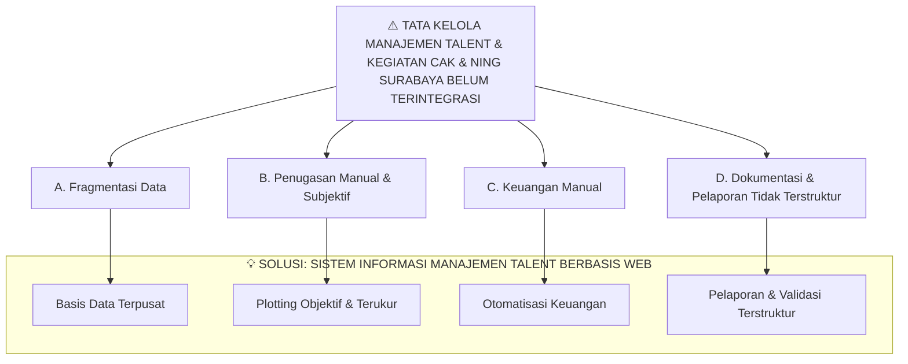

# 🏛️ Sistem Informasi Manajemen Talent & Kegiatan Cak & Ning Surabaya


## 📌 Latar Belakang & Analisis Masalah

> **Masalah Utama:** Tata Kelola Manajemen Talent & Kegiatan Cak & Ning Surabaya Belum Terintegrasi.

---

## 📊 1. Diagram Alir Masalah & Solusi (Mermaid Diagram)



---

## 📋 2. Matriks Analisis Masalah, Dampak & Solusi (Use Case)

| Kategori | Detail / Kondisi Lapangan | Dampak Masalah | Solusi & Feature (Use Case) |
| :--- | :--- | :--- | :--- |
| **A. Fragmentasi Data** | • Data tersebar di WA, Excel, GForm, GDrive<br>• Tidak ada basis data terpusat<br>• Pencarian data lama<br>• Duplikasi & inkonsistensi data | • Administrasi lambat<br>• Keputusan tidak berbasis data<br>• Pelayanan publik tidak optimal | **Basis Data Terpusat**<br>• Kelola User<br>• Kelola Client<br>• Kelola Sponsor<br>• Kelola Kegiatan<br>• Kelola Blog & Media<br>• Kelola Penugasan |
| **B. Penugasan Manual & Subjektif** | • Broadcast WA (FCFS tidak terukur)<br>• Tidak ada metrik keaktifan<br>• Plotting subjektif<br>• Kesenjangan jam terbang talent | • Distribusi tugas tidak adil<br>• Talent pasif / *underperform*<br>• Motivasi talent menurun | **Plotting Objektif & Terukur**<br>• Plotting Talent<br>• Kelola & Konfirmasi Penugasan<br>• Override & Auto-Expire |
| **C. Keuangan Manual** | • Rekap honor manual<br>• Potongan 10% manual<br>• Tidak ada audit trail<br>• Validasi berlapis tidak ada | • Risiko selisih saldo<br>• Keterlambatan pencairan honor<br>• Potensi *fraud* / kesalahan catat | **Otomatisasi Keuangan**<br>• Pembayaran Honor<br>• Kelola Modul Keuangan |
| **D. Pelaporan & Dokumentasi** | • Laporan via GForm & WA<br>• Form statis<br>• Validasi tidak terdokumentasi<br>• Arsip kegiatan tidak terkelola | • Citra organisasi kurang profesional<br>• Sulit proses regenerasi<br>• Kehilangan peluang kolaborasi | **Pelaporan & Validasi Terstruktur**<br>• Buat Laporan Penugasan<br>• Validasi Laporan Berlapis |

---

## 📐 3. Diagram Skema (ASCII Box)

```text
┌─────────────────────────────────────────────────────────────────────────────┐
│                    TATA KELOLA MANAJEMEN TALENT & KEGIATAN                  │
│                    CAK & NING SURABAYA BELUM TERINTEGRASI                   │
└─────────────────────────────────────────────────────────────────────────────┘
                                       │
        ┌───────────────┬─────────────┴─────────────┬───────────────┐
        ▼               ▼                           ▼               ▼
┌───────────────┐ ┌───────────────┐ ┌───────────────┐ ┌───────────────┐
│ A. FRAGMENTASI│ │ B. PENUGASAN  │ │ C. KEUANGAN   │ │ D. DOKUMENTASI│
│    DATA       │ │    MANUAL &   │ │    MANUAL     │ │    & PELAPORAN│
│               │ │    SUBJEKTIF  │ │               │ │    TIDAK      │
│               │ │               │ │               │ │    TERSTRUKTUR│
└───────┬───────┘ └───────┬───────┘ └───────┬───────┘ └───────┬───────┘
        │                 │                 │                 │
        ▼                 ▼                 ▼                 ▼
┌───────────────┐ ┌───────────────┐ ┌───────────────┐ ┌───────────────┐
│• Data tersebar│ │• Broadcast WA │ │• Rekap honor  │ │• Laporan via  │
│  di WA, Excel,│ │  → FCFS tidak │ │  manual       │ │  GForm & WA   │
│  GForm, GDrive│ │  terukur      │ │• Potongan 10% │ │• Form statis  │
│• Tidak ada    │ │• Tidak ada    │ │  manual       │ │• Validasi     │
│  basis data   │ │  metrik       │ │  tidak ada    │ │  tidak        │
│  terpusat     │ │  keaktifan    │ │• Tidak ada    │ │  terdokumentasi│
│• Pencarian    │ │• Plotting     │ │  audit trail  │ │• Arsip tidak  │
│  data lama    │ │  subjektif    │ │               │ │  terkelola    │
│• Duplikasi &  │ │• Kesenjangan  │ │               │ │               │
│  inkonsistensi│ │  jam terbang  │ │               │ │               │
└───────┬───────┘ └───────┬───────┘ └───────┬───────┘ └───────┬───────┘
        │                 │                 │                 │
        ▼                 ▼                 ▼                 ▼
┌───────────────┐ ┌───────────────┐ ┌───────────────┐ ┌───────────────┐
│ DAMPAK:       │ │ DAMPAK:       │ │ DAMPAK:       │ │ DAMPAK:       │
│• Administrasi │ │• Distribusi   │ │• Risiko       │ │• Citra kurang │
│  lambat       │ │  tugas tidak  │ │  selisih      │ │  profesional  │
│• Keputusan    │ │  adil         │ │  saldo        │ │• Sulit        │
│  tidak        │ │• Talent pasif │ │• Keterlambatan│ │  regenerasi   │
│  berbasis data│ │  under perform│ │  honor        │ │• Kehilangan   │
│• Pelayanan    │ │• Motivasi     │ │• Potensi      │ │  peluang      │
│  publik tidak │ │  menurun      │ │  fraud        │ │  kolaborasi   │
│  optimal      │ │               │ │               │ │               │
└───────┬───────┘ └───────┬───────┘ └───────┬───────┘ └───────┬───────┘
        │                 │                 │                 │
        ▼                 ▼                 ▼                 ▼
┌─────────────────────────────────────────────────────────────────────────────┐
│                              SOLUSI: SISTEM INFORMASI                       │
│                         MANAJEMEN TALENT CAK & NING BERBASIS WEB            │
└─────────────────────────────────────────────────────────────────────────────┘
        │                 │                 │                 │
        ▼                 ▼                 ▼                 ▼
┌───────────────┐ ┌───────────────┐ ┌───────────────┐ ┌───────────────┐
│ BASIS DATA    │ │ PLOTTING      │ │ OTOMATISASI   │ │ PELAPORAN &   │
│ TERPUSAT      │ │ OBJEKTIF &    │ │ KEUANGAN      │ │ VALIDASI      │
│               │ │ TERUKUR       │ │               │ │ TERSTRUKTUR   │
│               │ │               │ │               │ │               │
│ Use Case:     │ │ Use Case:     │ │ Use Case:     │ │ Use Case:     │
│• Kelola User  │ │• Plotting     │ │• Pembayaran   │ │• Buat Laporan │
│• Kelola Client│ │  Talent       │ │• Kelola       │ │• Validasi     │
│• Kelola       │ │• Kelola       │ │  Keuangan     │ │  Laporan      │
│  Sponsor      │ │  Penugasan    │ │               │ │               │
│• Kelola       │ │• Konfirmasi   │ │               │ │               │
│  Kegiatan     │ │  Penugasan    │ │               │ │               │
│• Kelola Blog  │ │• Override &   │ │               │ │               │
│• Kelola Media │ │  Auto-Expire  │ │               │ │               │
│• Kelola       │ │               │ │               │ │               │
│  Penugasan    │ │               │ │               │ │               │
└───────────────┘ └───────────────┘ └───────────────┘ └───────────────┘
```